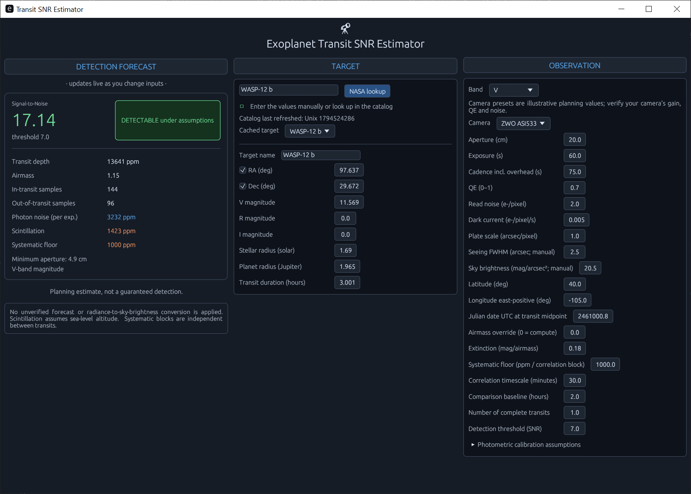

# Exoplanet Transit SNR Estimator

An application for estimating the detectability of exoplanet transits.\
Enter target and observing parameters manually, or retrieve target properties from the NASA Exoplanet Archive. 

The application provides planning estimates, not guaranteed detections. \
Calculations work offline with manual inputs or previously cached targets. New catalog lookups require internet access.

## Usage

1. In **Target**, enter a planet name such as `WASP-12 b` and click **NASA lookup**; select a cached record; or enter the values manually.
2. Supply a stellar radius in solar radii, planet radius in Jupiter radii, transit duration in hours, and magnitude for the selected observing band.
3. In **Observation**, configure aperture, exposure, cadence, camera characteristics, sky brightness, and noise assumptions.
4. Provide target coordinates, observing location, and UTC Julian date for calculated airmass, or enter a positive airmass override.
5. Set the out-of-transit comparison duration, number of transits, and SNR threshold.
6. Read the live **Detection forecast** and adjust settings to explore detection feasibility.

## Calculation model

Transit depth is estimated from the squared planet-to-star radius ratio, using 0.10045 to convert Jupiter radii to solar radii.

Stellar and sky signals are calculated from aperture area, exposure, magnitude, throughput, and quantum efficiency. Stellar extinction is referenced to airmass one. The extraction aperture has a radius of 1.5 times the seeing.

The noise model includes stellar and sky shot noise, detector read noise, dark current, and approximate sea-level scintillation. White noise is averaged over in-transit and out-of-transit samples. Systematic noise is averaged over blocks defined by the correlation timescale. Both assume independence between transits.

Detection SNR is transit depth divided by the combined uncertainty in the depth measurement. A binary search estimates the minimum aperture meeting the selected threshold within 1–2000 cm.

Airmass is calculated at the selected observation time or supplied manually. Clear-band calculations use V magnitude as a proxy. Results are planning estimates dependent on the calibration inputs and noise assumptions.

## Catalog and cache

Target data are retrieved from the NASA Exoplanet Archive TAP endpoint:

https://exoplanetarchive.ipac.caltech.edu/TAP/sync

Successful lookups are cached in 'transit_catalog_cache.json'

## Assumptions and limitations

- Detection status means the modeled SNR meets the chosen threshold under the supplied assumptions.
- Clear-band calculations use V magnitude as a proxy. Adjust the zero point and throughput for the actual optics, detector response, bandpass, and stellar spectrum.
- Default photometric calibration values are approximate; measured band-specific rates are preferable.
- Scintillation assumes sea-level altitude.
- Systematic blocks are assumed independent between transits.
- Airmass represents the selected observation time; the calculation does not integrate changing airmass over the transit.
- Transit depth uses a simple radius-ratio approximation rather than a detailed limb-darkened light-curve model.
- The evaluator uses transit duration to estimate samples and does not schedule transit windows from the fetched period and epoch.
- Weather forecasts and radiance-to-sky-brightness conversions are not applied.
